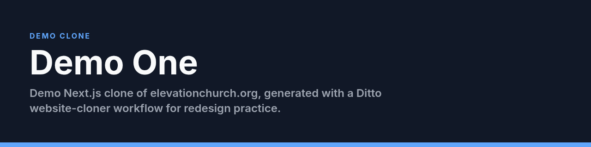

<p align="center">
  
</p>

# Demo One

**Demo Next.js clone of elevationchurch.org, generated with a Ditto website-cloner workflow for redesign practice.**

[](#license)


Source noted in the original README: cloned from https://www.elevationchurch.org/ on 2026-07-07. Treat as a redesign sandbox, not a production church site. IP ownership of the cloned brand assets is not claimed here.

## Features

- Next.js App Router pages and sections cloned for editing
- Tailwind CSS
- Local `npm run dev` / `build` / `start`

## Tech stack

- Next.js
- React
- TypeScript
- Tailwind CSS

## How to run

```bash
npm install
npm run dev
```

## Status

Public. Demo clone for redesign practice. Not for public launch as Elevation Church.

## License

All rights reserved for original edits. Cloned third-party brand materials remain their owners'.
